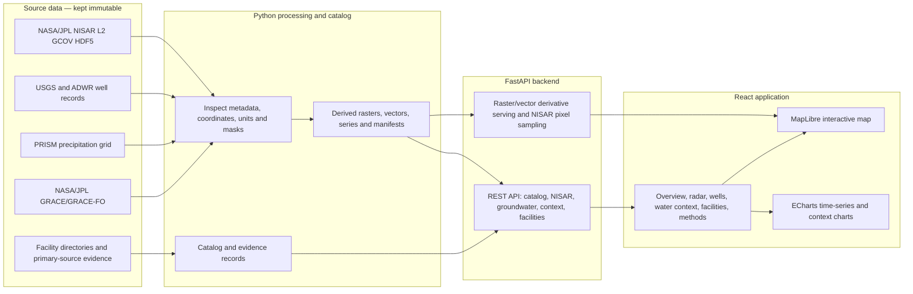
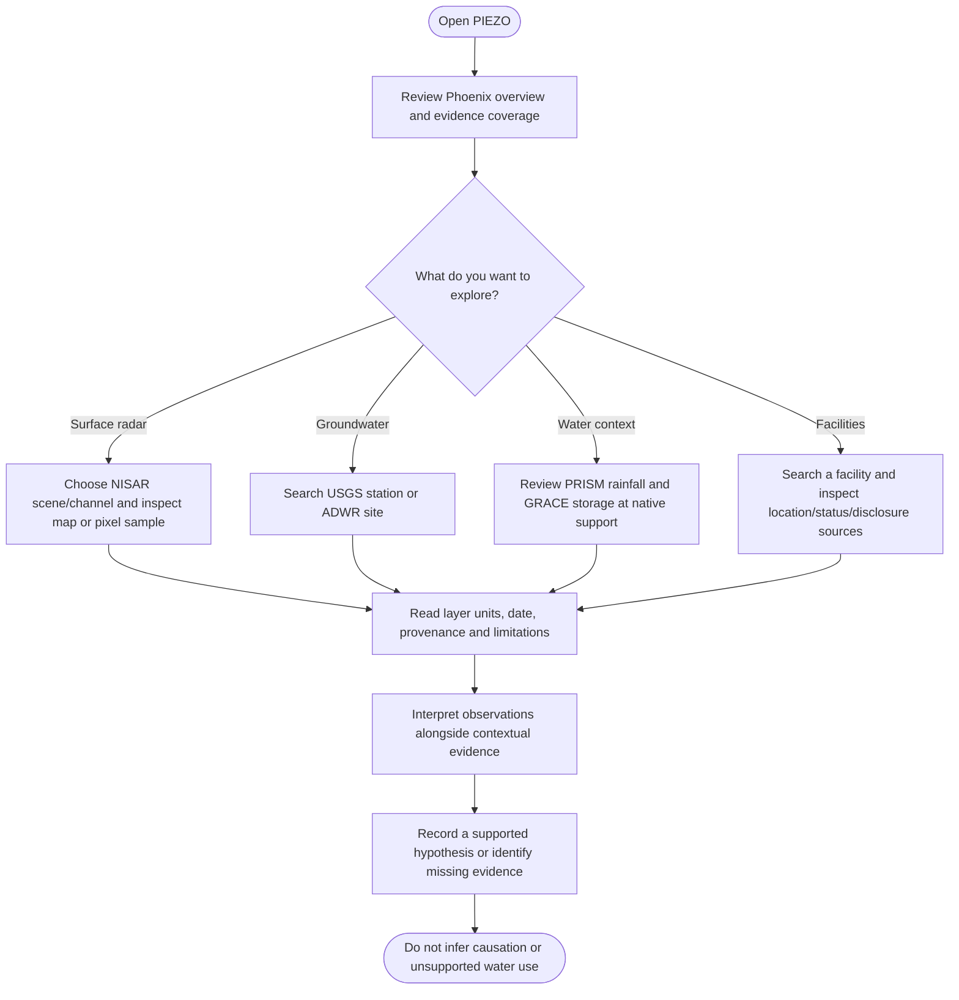

# Project PIEZO

**Made for NASA Space Apps Challenge**<br>
**Team:** Soham Gurav · Krutika Devare

PIEZO is an evidence-led geospatial observatory for Phoenix, Arizona. It brings together NISAR radar surface observations, groundwater measurements, precipitation, regional water-storage context, and source-backed data-centre evidence in an interactive map and dashboard. The project helps people explore environmental patterns while keeping observations, modeled context, and reported claims distinct.

> **Scientific scope:** Radar backscatter is not a direct measurement of groundwater, aquifer storage, or land subsidence. The available NISAR frames are adjacent scenes from the same pass and date, so they do not support a temporal change comparison. PIEZO presents evidence and limitations together; spatial coincidence does not establish causation.

## Demo screenshots

Screenshots below are from the running PIEZO application.

| Screenshot | Preview |
|---|---|
| Demo 1 |  |
| Demo 2 |  |
| Demo 3 |  |
| Demo 4 |  |
| Demo 5 |  |
| Demo 6 |  |
| Demo 7 |  |

## System architecture



Raw supplied datasets remain under `Datasets/`. Reproducible processors write derived products and manifests under `data/`; the API serves catalogs and derivatives without exposing raw multi-gigabyte HDF5 products to browsers. In the hosted configuration, the React/Vite frontend is deployed on Cloudflare Pages, FastAPI on Render, and the large NISAR Cloud Optimized GeoTIFFs (COGs) are read from Cloudflare R2. The local Vite server proxies `/api` and `/derived` to FastAPI.

## Use-case workflow



The workflow is intended for exploratory evidence review. It does not calculate a causal impact score or estimate data-centre water demand.

## Technology stack

| Area | Technologies and role |
|---|---|
| Frontend | React 19, TypeScript 5.8, Vite 6; application UI and development/build tooling. |
| Interactive mapping | MapLibre GL JS 5; geospatial basemap and raster/vector overlays. OpenStreetMap basemap use requires internet access. |
| Charts | Apache ECharts 6; groundwater observations, precipitation and GRACE time series. |
| Backend/API | Python 3.11+, FastAPI, Pydantic 2, Uvicorn; catalog, readiness, evidence, map-layer, sampling and data endpoints. |
| Geospatial/scientific processing | h5py, NumPy, Rasterio, pyproj, Shapely, pandas, xarray, netCDF4, pyshp and Pillow; HDF5/NetCDF reading, reprojection, raster/vector derivation and tabular preparation. |
| Data formats | HDF5, Cloud Optimized GeoTIFF/GeoTIFF, GeoJSON, JSON, CSV and NetCDF. |
| Deployment option | Cloudflare Pages (frontend), Render (API), Cloudflare R2 (large derived NISAR COGs). See [deployment notes](docs/DEPLOYMENT.md). |

## Scientific data and methods

PIEZO combines different evidence types while preserving each source's scale, units, period, and limitations:

- **NISAR L2 GCOV radar:** Geocoded covariance/backscatter response for HHHH and HVHV, Frequency A, processed for Phoenix from frame 71. Backscatter responds to dielectric properties, surface roughness, vegetation, viewing geometry, and acquisition conditions. It is not a direct water-table, groundwater-storage, or displacement measurement. Frames 71 and 72 are adjacent/overlapping coverage acquired on 2026-10-28 during the same descending pass (track 56), approximately 34 seconds apart; they are not separate dates for change detection. Source coordinates and EPSG:32612 metadata guide processing; invalid pixels are masked and derived products are recorded in manifests.
- **Groundwater observations:** USGS field measurements and Arizona Department of Water Resources (ADWR) GWSI inventory/level records are shown as measured at their documented sites and dates. Depth below land surface and water-level elevation are distinct quantities; parameters, units, measurement definitions, and datum context must not be mixed. No groundwater surface interpolation is implied.
- **Precipitation:** PRISM provides gridded modeled precipitation. The currently prepared view is an October 2026 monthly accumulation at about 30 arc-seconds (~800 m); the Phoenix-area value is a mean of valid grid-cell centers within the study rectangle, not an areal total. Rainfall alone does not establish aquifer recharge.
- **Regional water storage:** NASA/JPL GRACE/GRACE-FO RL06.3Mv04 CRI provides total water-storage anomaly for a coarse mascon (about 3° native support; 261 monthly records from 2002–2026 in the prepared series). It is not groundwater-only and cannot resolve individual facilities or wells.
- **Data-centre evidence:** Location, operating status, water source, and water quantity are separate claims requiring their own evidence. The current directory has six source-backed records; only Edged has source-published coordinates. No site-specific withdrawal or consumption quantity is verified. A proposed site is not treated as operating.

These layers can help users frame questions for further investigation. Temporal/spatial alignment is not proof that a facility caused a radar or groundwater pattern. See [scientific method](docs/SCIENTIFIC_METHOD.md), [data inventory](docs/DATA_INVENTORY.md), [facility evidence register](docs/FACILITY_EVIDENCE_REGISTER.md), and [known limitations](docs/KNOWN_LIMITATIONS.md) for details and provenance.

## Run locally

Requirements: Python 3.11+, Node.js and npm. On Windows, Rasterio may need a compatible wheel or a conda-forge environment.

Backend (from the repository root):

```powershell
py -3.11 -m venv .venv
.\.venv\Scripts\Activate.ps1
pip install -r backend\requirements.txt
uvicorn backend.app.main:app --reload --port 8000
```

Frontend (in a second terminal):

```powershell
cd frontend
npm install
npm run dev
```

Open the local Vite URL printed by npm. The Vite development server proxies `/api` and `/derived` to FastAPI on port 8000.

## Rebuild derived data

Keep source files under `Datasets/` unchanged. Run processors from the repository root as needed:

```powershell
.\.venv\Scripts\python.exe backend\scripts\inspect_nisar.py
.\.venv\Scripts\python.exe backend\scripts\process_nisar.py --channel HHHH --frequency frequencyA --skip-checksum
.\.venv\Scripts\python.exe backend\scripts\process_nisar.py --channel HVHV --frequency frequencyA --skip-checksum
.\.venv\Scripts\python.exe backend\scripts\prepare_groundwater.py
.\.venv\Scripts\python.exe backend\scripts\prepare_adwr_gwsi.py
.\.venv\Scripts\python.exe backend\scripts\prepare_basin_context.py
.\.venv\Scripts\python.exe backend\scripts\prepare_prism.py
.\.venv\Scripts\python.exe backend\scripts\prepare_grace.py
```

Scripts write generated products to `data/interim/`, `data/processed/`, and `data/manifests/`. Raw multi-gigabyte downloads and credentials should not be committed.

## Project documentation

- [Architecture](docs/ARCHITECTURE.md) · [API contract](docs/API.md) · [deployment](docs/DEPLOYMENT.md)
- [Scientific method](docs/SCIENTIFIC_METHOD.md) · [data inventory](docs/DATA_INVENTORY.md) · [data dictionary](docs/DATA_DICTIONARY.md)
- [Facility evidence register](docs/FACILITY_EVIDENCE_REGISTER.md) · [known limitations](docs/KNOWN_LIMITATIONS.md) · [implementation checklist](docs/IMPLEMENTATION_CHECKLIST.md)

## License

See [LICENSE](LICENSE).
